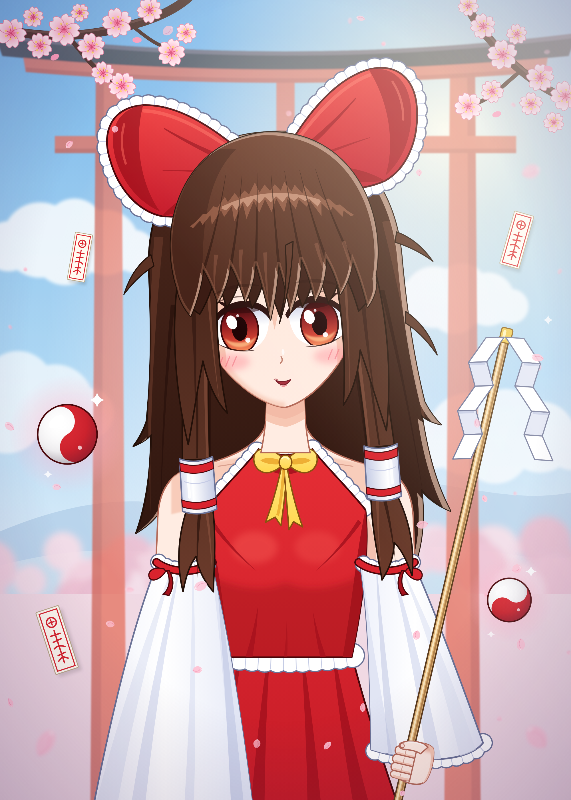

# 博丽灵梦 · Hakurei Reimu（纯代码绘制）



二次元（非像素）风格的博丽灵梦同人插画，**完全由代码生成**：没有任何位图素材，
所有元素（头发、蝴蝶结、巫女服、阴阳玉、御币、符札、樱花、鸟居）都是在
`reimu.mjs` 里手写的 SVG 贝塞尔路径 + 渐变 + 滤镜，最后用无头 Chromium 栅格化为 PNG。

```bash
node art/reimu/reimu.mjs            # 输出 reimu.svg 与 reimu.png（2000×2800）
SCALE=1 node art/reimu/reimu.mjs    # 1000×1400 预览
```

技法要点：

- 赛璐璐分层上色：底色 + `clipPath` 裁剪的阴影层 + 高光层（发顶“天使环”、发梢反光、右侧逆光描边用 `mask` 实现）
- 蕾丝花边：同一条路径叠加圆头虚线描边（扇贝边）与细虚线（褶皱），见 `frill()`
- 头部整体 `rotate(-4°)` 打破对称；眼睛高光不随镜像翻转，保持同一光源方向
- 樱花花瓣、远景樱树用固定种子的伪随机数排布，每次生成结果一致

Hakurei Reimu © ZUN / Team Shanghai Alice — fan art.
